# Build a Supplier Disruption Response Agent on SAP S/4HANA

<!-- description -->In this session, you will build a production-grade AI agent from scratch using the Joule Studio Local / CLI flow. The agent connects to SAP S/4HANA Public Cloud and automates the end-to-end response to a supplier disruption event: from identifying at-risk purchase orders and scheduling agreements to delivering a risk-scored, fully labeled assessment report.

## Prerequisites

- Access to Joule Work and Joule Studio
- VS Code installed on your session laptop
- [`jl` CLI (Joule Studio CLI)](https://help.sap.com/docs/joule-studio/joule-studio/joule-studio-for-cli-pro-code-development-in-joule-studio)
- any compatible coding agent (e.g. OpenCode)

> **No starter repo needed.** You create everything from scratch using the IBD flow.


## You will learn

After completing this session, you will be able to:

1. Use the Joule Studio **local / CLI** IBD flow end-to-end: Intent → PRD → Specification → Implementation
2. Discover SAP APIs via the SAP Knowledge Graph and generate MCP servers from OpenAPI and EDMX specs
3. Build a multi-API AI agent on SAP S/4HANA Public Cloud from scratch
4. Implement risk scoring and output labeling as production-grade agent guardrails
5. Deploy and test an AI agent via the Joule Studio CLI (`jl`) and interact with it through SAP Joule

### Introduction

In this session, you will build a production-grade AI agent from scratch using the **Joule Studio Local / CLI flow**. The agent connects to SAP S/4HANA Public Cloud and automates the end-to-end response to a supplier disruption event — from identifying at-risk purchase orders and scheduling agreements to delivering a risk-scored, fully labeled assessment report.

#### What is Joule Studio?

**Joule Studio** is SAP's platform for building, deploying, and managing AI agents. It provides an end-to-end development experience — from describing what you want in plain language to running a production agent in SAP AI Core, accessible via SAP Joule.

Joule Studio supports two development modes:

| Mode | Who it's for | How it works |
|------|-------------|--------------|
| Web | Developers, business analysts | Visual flow builder in a browser |
| **Local / CLI** | Developers, technical PMs | `jl` CLI + coding agent (e.g. OpenCode) on your laptop |


In this session, you use the **local / CLI** path. The core mechanic is **Intent-Based Development (IBD)**: you describe the agent's goal in plain language, and Joule Studio's IBD engine generates a PRD, a technical specification, and a full implementation — which you then review, extend, and deploy.

#### Scenario

You are a **Procurement Manager** at a mid-sized manufacturer. A key supplier has just announced a production halt due to a logistics disruption. You have open purchase orders and scheduling agreements in SAP S/4HANA — but coordinating a triage response manually takes hours.

By the end of this session your agent will:

1. Accept a disruption signal (event type, country, date)
2. Retrieve all at-risk open POs and scheduling agreement lines from SAP S/4HANA
3. Score each item **HIGH / MEDIUM / LOW** using a composite risk model
4. Present a fully labeled assessment — every claim tagged `[Confirmed Fact]`, `[Assumption]`, or `[Recommendation]`

```
┌─────────────────────────────────────────────────────────────────────────┐
│               Supplier Disruption Response Agent                        │
│                    LangGraph · Joule Studio                             │
└──────────────────────────┬──────────────────────────────────────────────┘
                           │
      ┌────────────────────▼────────────────────┐
      │  M1 — Signal Detection & Classification  │
      └────────────────────┬────────────────────┘
                           │
      ┌────────────────────▼────────────────────┐
      │       M2 — SAP Data Retrieval            │◄── S/4HANA: Purchase Orders
      │                                          │◄── S/4HANA: Scheduling Agreements
      └────────────────────┬────────────────────┘
                           │
      ┌────────────────────▼────────────────────┐
      │    M3 — Impact & Risk Assessment         │
      │    HIGH / MEDIUM / LOW per line item     │
      └────────────────────┬────────────────────┘
                           │
      ┌────────────────────▼────────────────────┐
      │   M4 — Consolidated Risk Report          │
      │   Labeled exposure summary presented     │
      │   to procurement manager                 │
      └─────────────────────────────────────────┘

  Every output: [Confirmed Fact] | [Assumption] | [Recommendation]
```

#### Business Outcomes

| Metric | Current (manual) | Target (agent) |
|--------|-----------------|----------------|
| Time to identify at-risk POs | Hours | < 15 minutes |
| Full risk-scored triage done | Hours | < 30 minutes |
| Recommendation traceability | Ad hoc | 100% labeled |

#### System Architecture

| MCP Server | SAP System | API | Type |
|-----------|-----------|-----|------|
| `sap-s4-purchase-order-mcp-server` | SAP S/4HANA Public Cloud | `CE_PURCHASEORDER_0001` | Read |
| `sap-s4-scheduling-agreements-mcp-server` | SAP S/4HANA Public Cloud | `API_SCHED_AGRMT_PROCESS_SRV` | Read |

Both MCP servers are generated during the exercise using the MCP Builder in Joule Studio.

### Set Up Your Environment

In this exercise you will open VS Code, create your working folder, log into the provided Joule Studio landscape, and launch the coding agent. This takes about 10 minutes.

> **Note — Coding agent**
> You can choose a coding agent based on your preferences or your company policies. In this tutorial OpenCode will be shown as an example. All the supported coding agents will use the same IBD flow — every step in these exercises is identical regardless of which one is installed. To check which coding agents are supported, run the following command in the terminal: `jl init -h`

#### Open VS Code

1. Click **Visual Studio Code** on the desktop (or taskbar)
2. If a "Sign in" or welcome page opens, close it

    <!-- border -->
    

#### Create Your Working Folder

1. In VS Code, open the Explorer panel on the left sidebar (`Ctrl+Shift+E` / `Cmd+Shift+E`)
2. Click **Open Folder**
3. Navigate to your **Desktop**
4. Create a new folder with some unique name (e.g. `supplier-agent-123`)
5. Select the folder and click **Open**


    <!-- border -->
    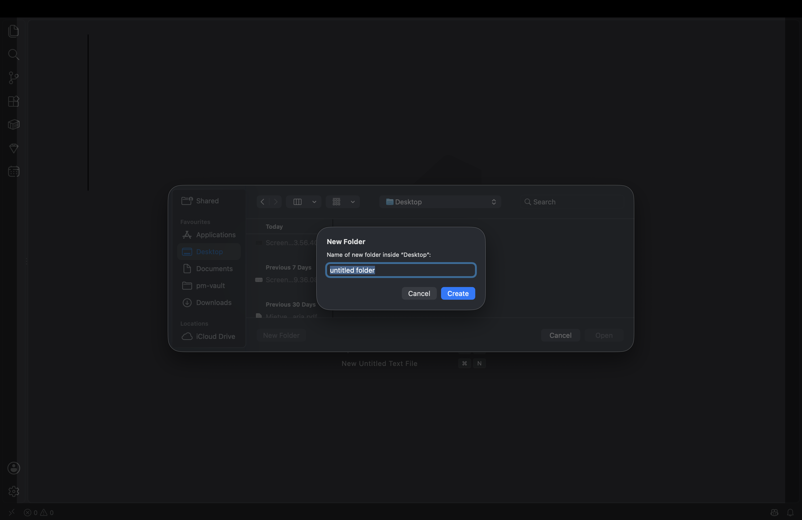

    You should now see an empty Explorer panel with the folder name at the top left.

    <!-- border -->
    

> **Tip:** If VS Code asks "Do you trust the authors?" — click **Yes, I trust the authors**.

#### Open a Terminal

1. Open a terminal in VS Code:
   - Menu: `…` → **Terminal** → **New Terminal**
   - Shortcut: `` Ctrl+` `` (Windows/Linux) · `` Cmd+` `` (Mac)
2. A terminal panel opens at the bottom. Confirm it shows your project folder as the current directory.

    <!-- border -->
    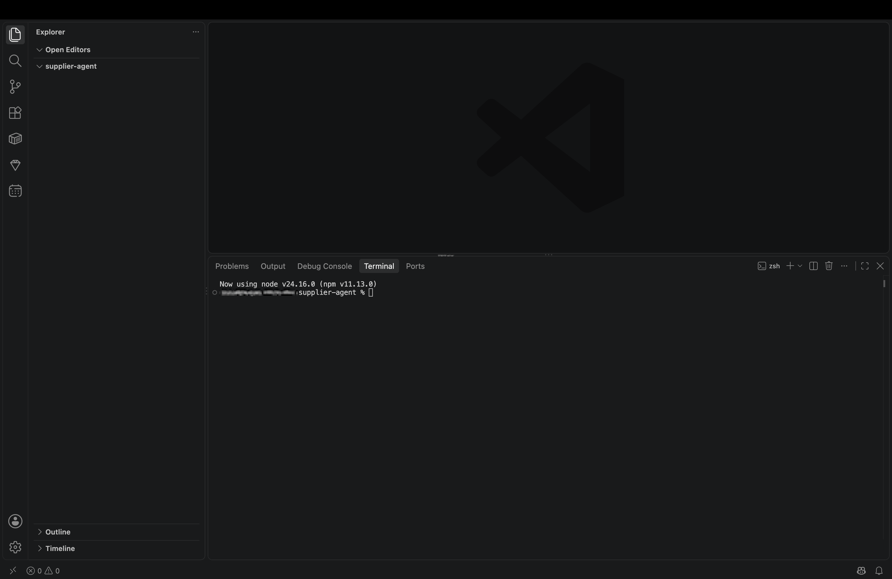

#### Verify the CLI

```bash
jl --help
```

You should see the full list of available Joule Studio CLI commands.

<!-- border -->
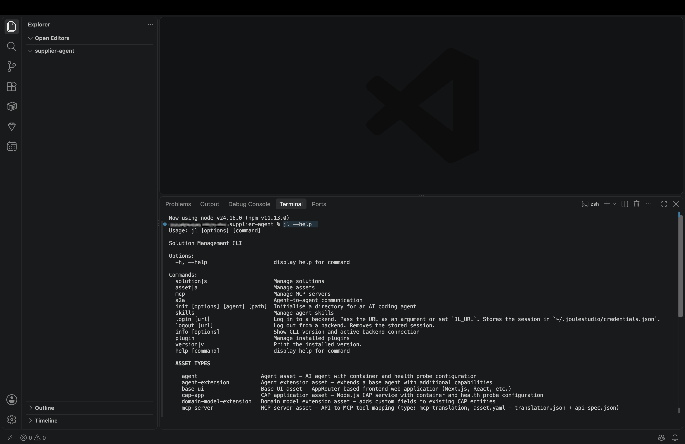

Then check the installed version:

```bash
jl version
```

<!-- border -->
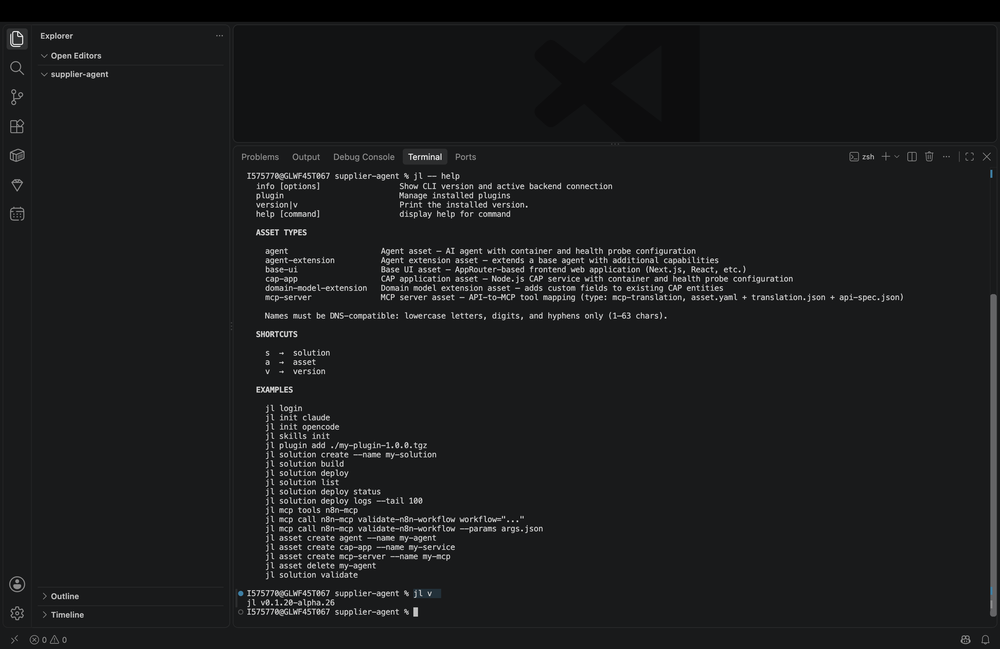

#### Log In

Before running `jl login`, get your personal Sign-in URL from the Joule Studio web UI:

1. Open Joule Studio in your browser

    <!-- border -->
    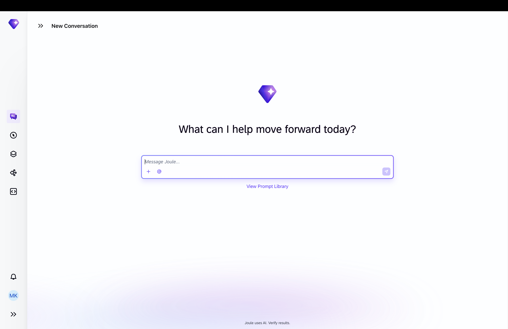

2. Select your user icon in the bottom-left corner → **Settings**

    <!-- border -->
    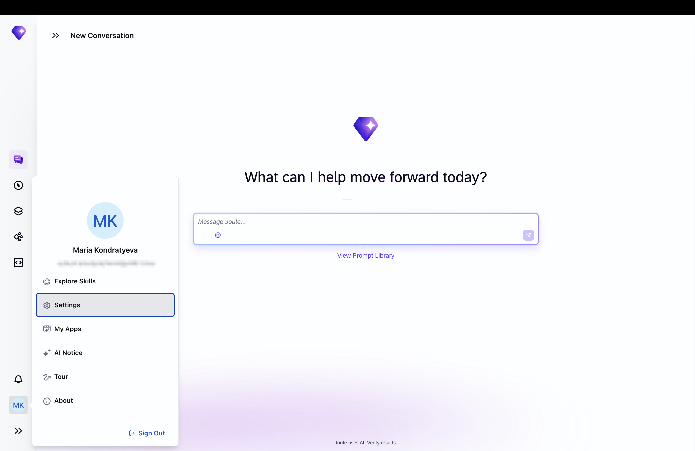

3. Go to **Develop** → under **CLI Authorization**, copy the Sign-in URL

    <!-- border -->
    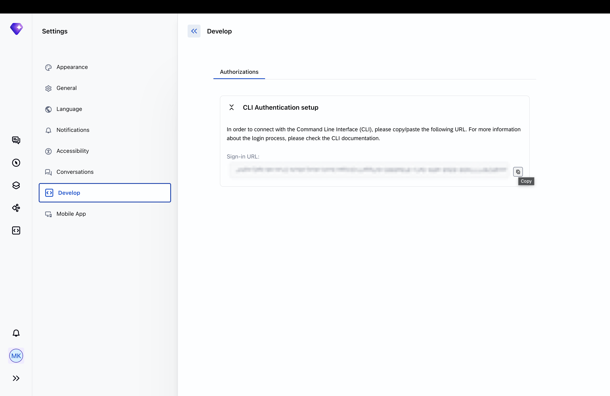

Back in the terminal, pass the URL to `jl login` — wrap it in single quotes:

```bash
jl login '<your Sign-in URL>'
```
<!-- border -->
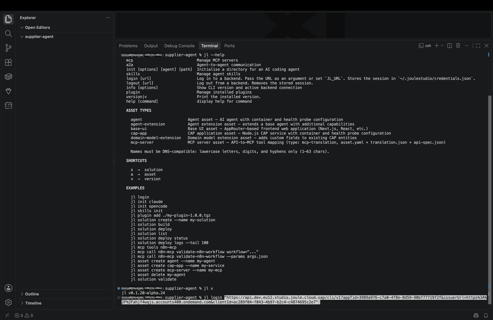

A browser window opens for authentication. Once confirmed, the CLI stores the session.

> **Tip:** After the first login, running `jl login` without an argument reuses the stored URL.
>
> **Login expired?** If you see `401 Unauthorized`, run `jl login` again before retrying.

### Initialize the Project

Run `jl init` command with the selected coding agent as an argument. For example for OpenCode use the following syntax:

```bash
jl init opencode
```

`jl init` sets up the Joule Studio project in your current folder — it fetches the IBD skills into `skills/` folder (correct path depends on the selected coding agent) and writes other configuration files.

<!-- border -->
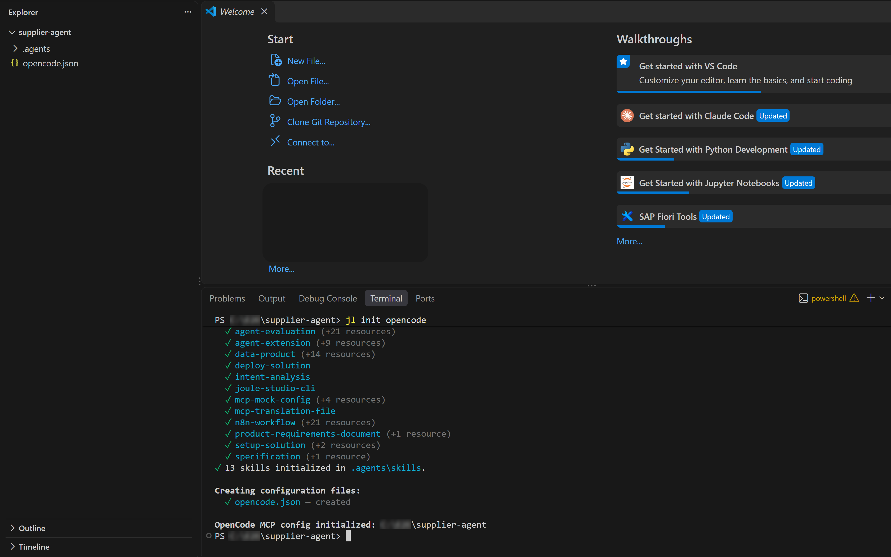

> **Do not modify the IBD skills.** The files in the `skills/` folder encode deployment conventions. Customize your agent through its own code, not through the skills that generate it.

#### Launch the Coding Agent

Run your coding agent. For example, for OpenCode use the following command:

```bash
opencode
```

The coding agent opens — a chat interface inside the terminal.

<!-- border -->
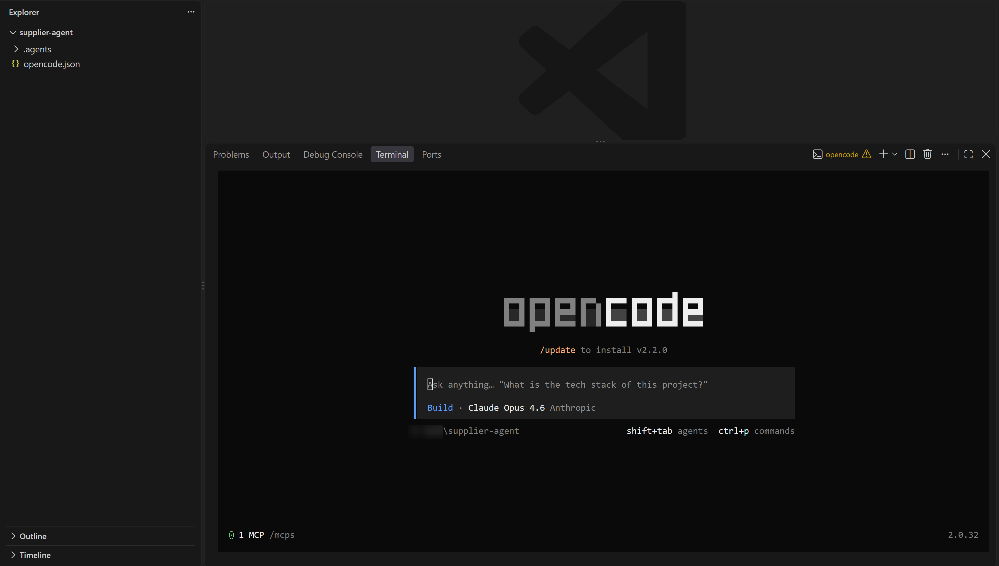

> **Auto-approve mode**
> Use [auto-approve mode](https://opencode.ai/docs/permissions/) for your coding agent to avoid approving of every step. Make sure that you accept the risks of this mode.
> - **opencode**: append `--auto` when launching: `opencode --auto`

<!-- border -->
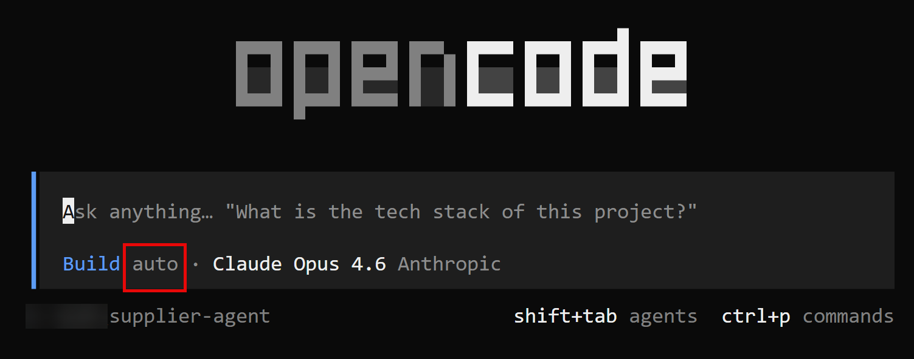


```
Desktop/
└── <your-project-name>/
    └── .agents/skills/ ← IBD skills
        opencode.json ← MCP and permissions config
```

The coding agent is running and waiting for input.

---

### Enter Your Intent

In this exercise you will submit your intent prompt to the IBD coding agent. The tool will analyze your intent, map it to SAP's Reference Business Architecture, and ask clarifying questions before generating the solution documents.

#### Enter the Intent Prompt

In the coding agent chat, paste the following prompt and press **Enter**:

```
I am a procurement manager at a manufacturing company using SAP S/4HANA Public Cloud. Our key supplier in Taiwan has just announced a production halt due to a factory fire starting today.

I need an agent that:
1. Retrieves all open purchase orders and scheduling agreements linked to affected suppliers in SAP S/4HANA
2. Scores each item HIGH / MEDIUM / LOW based on delivery proximity, open value, and geographic overlap

Rules the agent must follow:
- Every output must be labeled [Confirmed Fact], [Assumption], or [Recommendation]
```

> **In a hurry?** Add `FastTrack.` to the end of your prompt to skip all questions and go straight to the result.

<!-- border -->
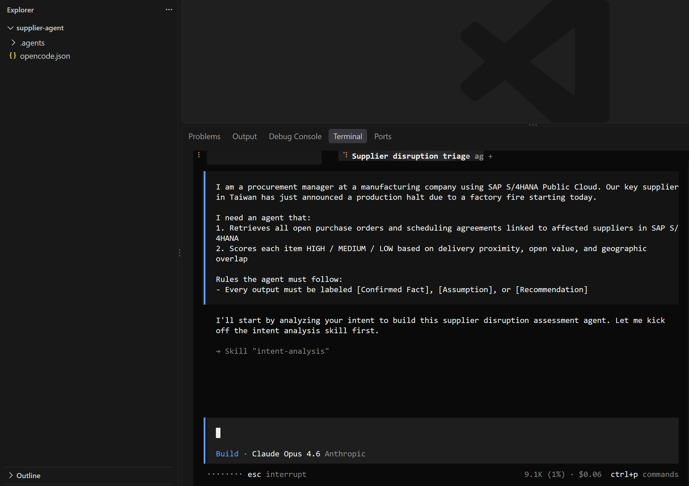

The IBD skill loads and begins the intent analysis pipeline.

> **Note — Every IBD run looks different — that is expected.**
> IBD uses an LLM to interpret your intent, so the exact wording of clarifying questions, the order of steps, and the generated document content will vary between runs and between participants. Focus on the checklists, not the screenshots.

#### Answer Clarifying Questions

IBD will ask follow-up questions before generating the intent document. Use this cheat sheet to answer quickly.

<!-- border -->
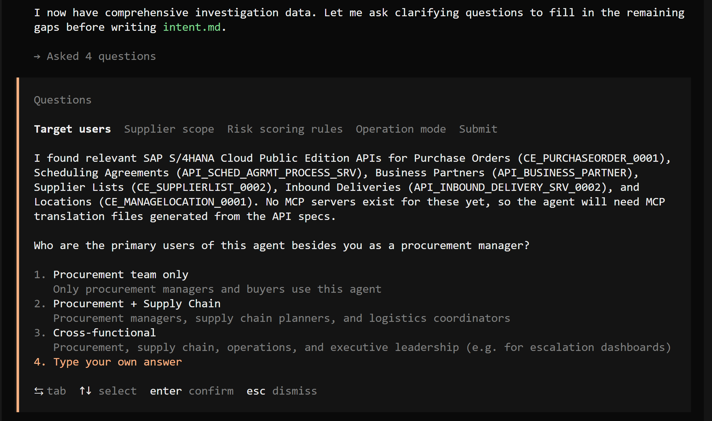

##### Cheat sheet

**"What does success look like?"**
→ Cover 100% of affected purchase orders within 15 minutes; full risk-scored triage report ready within 30 minutes.

**"Which SAP systems are involved?"**
→ `SAP S/4HANA Public Cloud` — purchase orders and scheduling agreements both come from S/4HANA.

**"What is the business process?"**
→ `Source to Pay` — specifically the supplier disruption response part.

**"Are there any compliance or auditability requirements?"**
→ `Yes` — every piece of information must be labeled: `[Confirmed Fact]` for data retrieved from SAP, `[Assumption]` for scoring thresholds, `[Recommendation]` for suggested actions.

**"What is the urgency / timeline?"**
→ All affected POs and scheduling agreements must be triaged within 30 minutes of the disruption signal.

**"Which APIs or data sources should the agent use?"**
→ Only use APIs from the available list: `CE_PURCHASEORDER_0001`, `API_SCHED_AGRMT_PROCESS_SRV`, and `CE_SUPPLIERLIST_0001`. All other APIs are not registered on this tenant and will fail at deployment.

After answering all questions, IBD shows a summary for review:

<!-- border -->
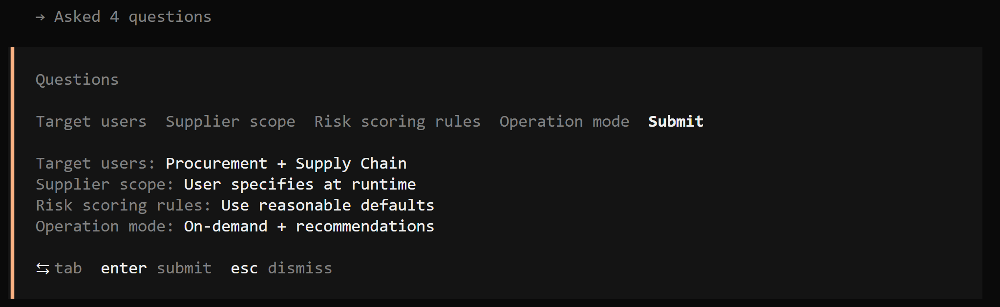

IBD then presents a Business Goals & Success Criteria table and asks you to confirm:

<!-- border -->
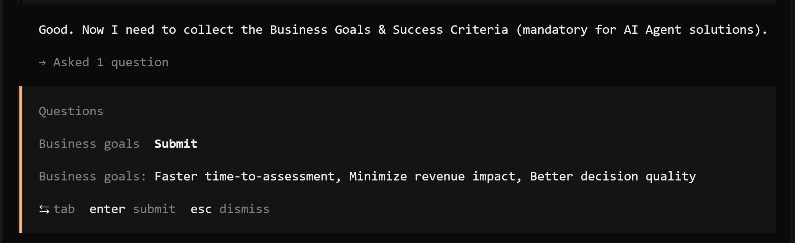

<!-- border -->
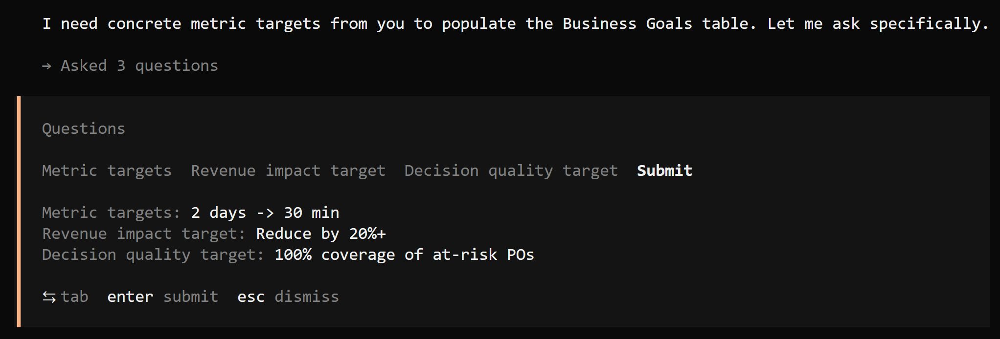


#### What is Happening Behind the Scenes

| Stage | What the tool does |
|-------|-------------------|
| **Parse** | Structures your intent into a machine-readable problem definition |
| **RBA Mapping** | Maps to SAP Reference Business Architecture → Source to Pay (BPS-329, BPS-340) |
| **Fit-Gap Analysis** | Queries SAP Knowledge Graph to assess which capabilities cover your intent |
| **API Discovery** | Discovers APIs from the available set: `CE_PURCHASEORDER_0001`, `API_SCHED_AGRMT_PROCESS_SRV`, `CE_SUPPLIERLIST_0001` |
| **Intent Fit Score** | Scores how closely the proposed solution matches your requirement (target: ≥ 0.7) |

> **Low intent fit score?** If the score is below 0.7, check that SAP S/4HANA Public Cloud was named explicitly and that both APIs are in your intent statement.

#### Review and Save `intent.md`

When the analysis completes, IBD generates `intent.md`. You may be asked to confirm the intent draft. Just accept it. 

Open `intent.md` in the editor to read the full structured document:

<!-- border -->
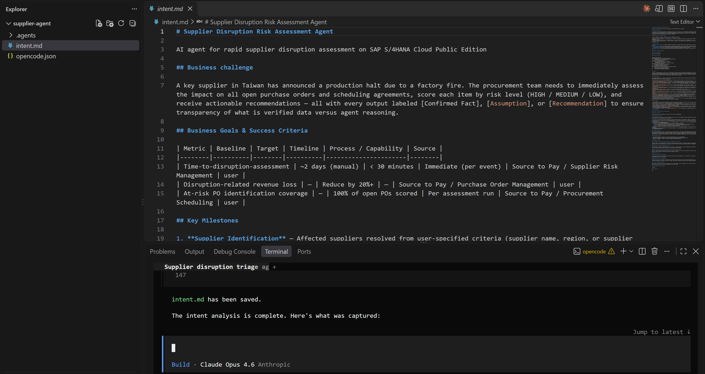

### Review Intent, PRD & Specification

In this exercise you will review the three documents IBD generates before writing any code: `intent.md`, `product-requirements-document.md`, and `specification.md`.

> **Note — IBD variance is normal.** The document structure, section names, and content depth vary between runs. Use the checklists below to verify the substance is correct.

#### API Availability on This Tenant

Use this table when reviewing the PRD and specification. IBD may discover APIs valid in the SAP API catalogue but not registered on this tenant — those will fail at deployment.

| API ORD ID | Description | Available on tenant |
|-----------|------------|---------------------|
| `sap.s4:apiResource:CE_PURCHASEORDER_0001:v1` | Purchase Orders (Cloud Edition) | ✅ Yes |
| `sap.s4:apiResource:API_SCHED_AGRMT_PROCESS_SRV:v1` | Scheduling Agreements | ✅ Yes |
| `sap.s4:apiResource:CE_SUPPLIERLIST_0001:v1` | Preferred Supplier List (Cloud Edition) | ✅ Yes |
| `sap.s4:apiResource:CE_SUPPLIERLIST_0002:v1` | Preferred Supplier List v2 | ❌ No |
| `sap.s4:apiResource:OP_SUPPLIERLIST_0002:v2` | Preferred Supplier List (On-Premise) | ❌ No |
| `sap.s4:apiResource:CE_SOURCINGSUPPLIERLIST_0001:v1` | Sourcing Supplier List | ❌ No |
| `sap.s4:apiResource:API_BUSINESS_PARTNER:v1` | Business Partner | ❌ No |
| `sap.s4:apiResource:API_PURCHASEORDER_PROCESS_SRV:v1` | Purchase Orders (On-Premise) | ❌ No |

#### Review `intent.md`

`intent.md` was generated automatically at the end of Exercise 1. Open it from the VS Code Explorer panel.

**Check the following:**
- SAP Source-to-Pay is identified as the business process domain
- SAP S/4HANA Public Cloud is named as the source system
- A fit-gap analysis was conducted (existing APIs vs. agent requirements)
- A pro-code Python AI agent is the recommended solution type

    <!-- border -->
    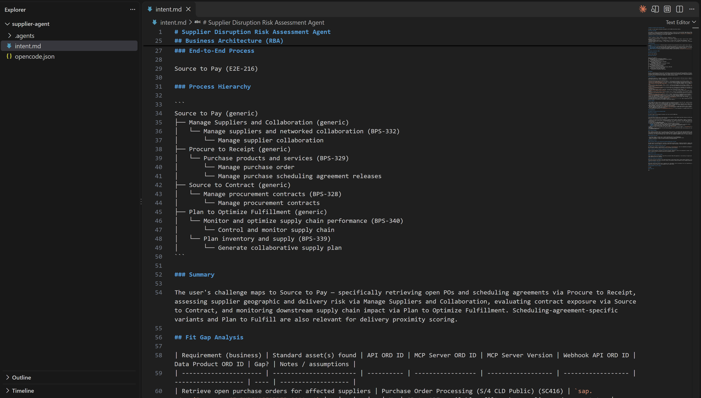

> **Refining intent:** If something important is missing, type a correction before proceeding. Example:
> `"Also add: the risk score must show the scoring rationale for each line item, not just the label."`

When you are satisfied, type in the coding agent:

```
Continue with PRD
```
<!-- border -->
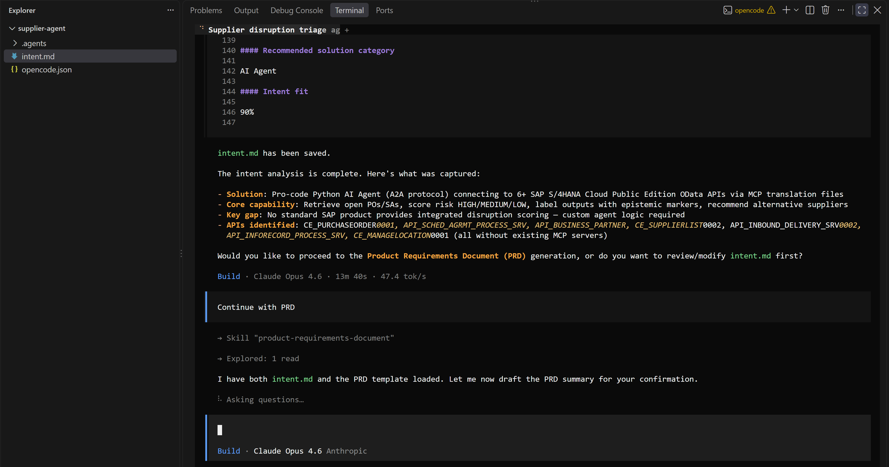

#### Review the PRD

IBD generates `product-requirements-document.md`. 

**Check the following:**
- Business metrics are meaningful and match your input intent
- Personas for the use case are well defined
- Solution architecture lists exactly S/4HANA MCP servers available on this tenant
- All milestones are represented as named functional requirements
- The composite risk scoring model (HIGH / MEDIUM / LOW) is described as a functional requirement

<!-- border -->
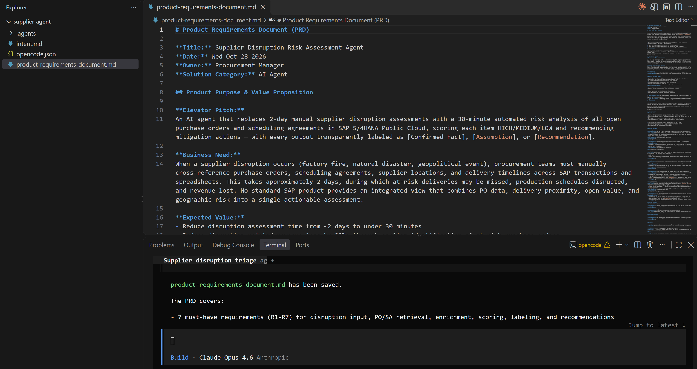


When ready, type:

```
Create specification
```
<!-- border -->
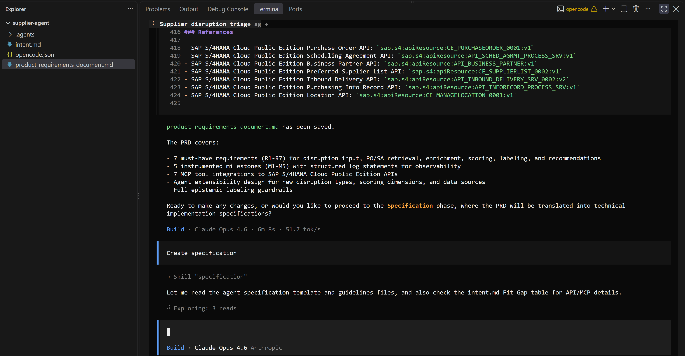

#### Review the Specification

IBD generates `specification.md` inside `specification/your-agent-name/`.

**Check the following:**
- A `specification/` folder was created
- Exactly **two or three** S/4HANA MCP servers listed — only from available APIs: `CE_PURCHASEORDER_0001`, `API_SCHED_AGRMT_PROCESS_SRV`, `CE_SUPPLIERLIST_0001`
- A `risk_scoring` logic is described
- Guidance for the agent is captured in `.md` skill files

> **Unregistered API in the spec?** If the spec lists any API **not** in the available list, stop here and correct it. Tell the coding agent:
> `"Remove [API name] from the specification and only use APIs from the available list."`

<!-- border -->
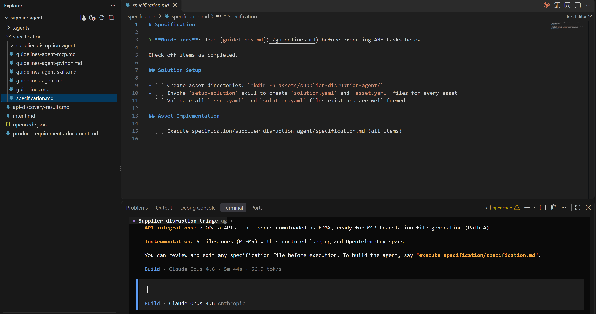

When ready, type:

```
Execute specification
```

<!-- border -->
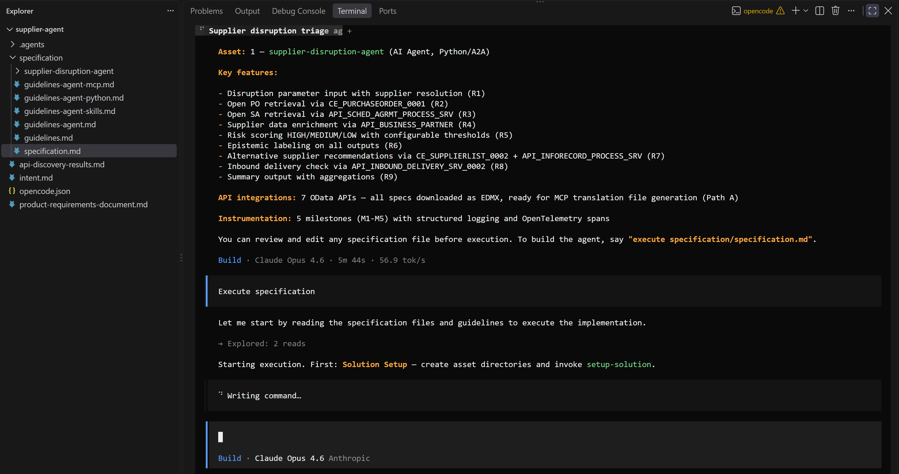

After execution, the full agent file structure is generated:

<!-- border -->
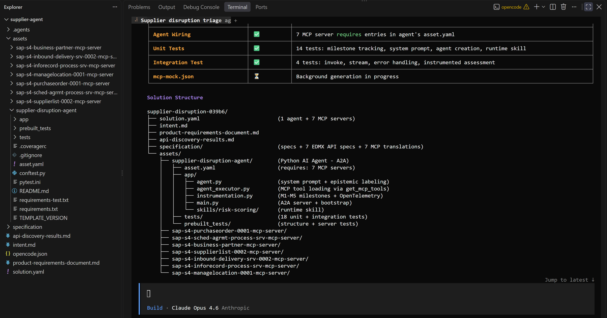

#### What Happened Behind the Scenes

| Document | Generated by | Purpose |
|----------|-------------|---------|
| `intent.md` | Intent analysis pipeline | Machine-readable problem definition with fit-gap analysis |
| `product-requirements-document.md` | PRD generator | Functional and non-functional requirements |
| `specification.md` | Spec generator | Implementable task list the coding agent executes in Exercise 3 |


### Implementation & Code Review

The coding agent is now implementing the solution from the specification. This takes **10–20 minutes**. Work through the steps below while it runs.

> **Tip:** If the coding agent pauses, type `continue`.

> **Note — IBD variance is normal.** The generated code, file names, and implementation choices will differ between participants — even with the same intent prompt. The hunts below are designed to work regardless of which pattern your generation chose.

#### Code Hunt

Use **Ctrl+P** (Cmd+P on Mac) to open files by name.

##### Hunt 1 — `app/agent.py`

Find the `get_model_name()` function — decorated with `@agent_model`:

```python
@agent_model(key="config.model", label="LLM Model")
def get_model_name() -> str:
    return "sap/anthropic--claude-4.5-sonnet"   # primary model
```

- Found it. What model is set as primary in your file?

Find the OTel milestone logging — `logger.info` calls containing milestone markers:

```python
logger.info("[M1.achieved]: MCP tools loaded successfully — proceeding with agent")
...
logger.info("[M5.achieved]: Risk assessment report delivered to requestor")
```

- Found milestone logging. How many milestones are instrumented?

##### Hunt 2 — Risk Scoring

IBD can implement risk scoring as a Python file (`app/tools/scoring_engine.py`), a runtime skill (`app/skills/risk-scoring/SKILL.md`), or inline in `agent.py`.

- Located the risk scoring logic — is it a Python file, a skill file, or inside `agent.py`?
- Found the HIGH / MEDIUM / LOW threshold values — what are they in your generation?

```python
DELIVERY_HIGH_DAYS = int(os.getenv("DELIVERY_HIGH_DAYS", "14"))
VALUE_HIGH_EUR     = float(os.getenv("VALUE_HIGH_EUR", "50000"))
```

- The thresholds are labeled `[Assumption]` — why does that distinction matter for the procurement manager?

##### Hunt 3 — Output Labeling

Find where `[Confirmed Fact]`, `[Assumption]`, and `[Recommendation]` labels are applied:

```python
def label_confirmed_fact(value, field_name=""):
    return {"label": "[Confirmed Fact]", "field": field_name, "value": value}
```

- Found the labeling logic
- API-retrieved values (PO number, supplier, delivery date) are labeled `[Confirmed Fact]`
- Scoring thresholds and geographic assumptions are labeled `[Assumption]`
- Suggested re-routing actions are labeled `[Recommendation]`

##### Hunt 4 — MCP Tool Indirection (`app/mcp_tools.py`)

Find `app/mcp_tools.py` — a thin wrapper:

```python
from sap_cloud_sdk.agentgateway import get_mcp_tools
__all__ = ["get_mcp_tools"]
```

- Found it. Why does `agent_executor.py` import from `mcp_tools` instead of directly from the SDK?

> This is the patch target in tests — `conftest.py` mocks `get_mcp_tools` here so tests never need a live Agent Gateway connection.

##### Hunt 5 — Tests

Open the `tests/` folder inside your agent asset directory.

- At least one test file per tool (`test_scoring_engine.py`, `test_labeling.py`, etc.)
- An integration test (`test_integration.py`) that exercises the full pipeline without network calls
- A `conftest.py` that patches `get_mcp_tools` so tests run offline

#### Verify the Generated File Structure

```
<your-project-folder>/
├── solution.yaml                    ← solution manifest listing all assets
├── assets/
│   ├── <your-agent-name>/
│   │   ├── asset.yaml
│   │   ├── mcp-mock.json
│   │   ├── tests/
│   │   │   └── test_*.py
│   │   └── app/
│   │       ├── agent.py
│   │       ├── agent_executor.py
│   │       ├── main.py
│   │       ├── skills/
│   │       │   └── <skill-name>/
│   │       │       └── SKILL.md
│   │       ├── tools/
│   │       │   └── *.py
│   │       └── mcp_providers/
│   │           └── agw.py
│   ├── <s4-purchase-order-mcp-server>/
│   │   └── mcp-translation/
│   │       ├── translation.json
│   │       └── api-spec.edmx
│   └── <s4-scheduling-agreements-mcp-server>/
│       └── mcp-translation/
│           ├── translation.json
│           └── api-spec.edmx
```

**Check the following:**

- `solution.yaml` exists at the project root and lists all asset folders
- MCP server asset folders exist only for registered APIs
- Each MCP server has a `mcp-translation/` folder with `translation.json` and an API spec file
- A `tests/` folder exists inside the agent folder with test files

> **Unexpected MCP server folders?** Tell the coding agent:
> `"Remove the [name] MCP server asset — only CE_PURCHASEORDER_0001, API_SCHED_AGRMT_PROCESS_SRV, and CE_SUPPLIERLIST_0001 are registered on this tenant."`

### Deploy & Test Your Agent

In this exercise you will deploy your agent to Joule Studio and run the full supplier disruption scenario.

#### Configure Mock Data Mode

Open `assets/your-agent-name/asset.yaml` and add an `env` block:

```yaml
container:
  buildPath: .
  port: 5000
  env:
    - name: IBD_TESTING
      value: "1"
```

> **Why this matters:** With `IBD_TESTING=1` the agent runs against mock data instead of live S/4HANA APIs. Results are predictable and the exercise works regardless of whether live S/4 services are fully provisioned.

#### Validate and Deploy

Ask the coding agent to deploy:

```
deploy the agent
```

The agent is packaged and deployed to SAP managed Joule Studio runtime. This takes **1–2 minutes**. `jl solution validate` runs automatically in the background.

#### Verify the Agent is Reachable

**Option A — Joule Studio web UI:** Open the deployed agent in Joule Studio and start a conversation directly.

**Option B — Coding agent:**

```
Use Joule to send a 'hi' to my agent.
```

**Option C — A2A CLI:**

```bash
jl a2a message "hi" --solution <your-solution-id> --asset <your-agent-name>
```

The agent should respond with a brief greeting. If it times out, ask a session guide to check the deployment status.

### Run the Disruption Scenario

Send the full test message:

```
Our supplier in Taiwan has announced a factory fire.
The disruption started on 2024-03-01. What purchase orders and scheduling
agreements are at risk?
```

Work through this checklist:

**M1 — Signal intake**
- Agent confirms it received the event type (factory fire), country (Taiwan), and date (2024-03-01)
- Agent states it is beginning the triage sequence

**M2 — SAP Data Retrieval**
- Open purchase orders returned for suppliers in Taiwan, labeled `[Confirmed Fact]`
- Scheduling agreement lines returned, labeled `[Confirmed Fact]`

**M3 — Risk Scoring**
- Each line item is assigned HIGH, MEDIUM, or LOW
- Scoring rationale is shown (delivery proximity, open value, geographic overlap)
- Scoring thresholds are labeled `[Assumption]`
- Results sorted HIGH → MEDIUM → LOW

**M4 — Consolidated Risk Report**
- Risk-scored exposure summary presented with all items labeled
- Recommended actions labeled `[Recommendation]`

> **Use OTEL traces to debug:** If the agent skips a milestone, open the **Tracing** tab in Joule Studio — each span shows which tool was called, with what inputs, and how long it took.


```
Taiwan factory fire signal
        ↓
M1  Disruption intake confirmed
        ↓
M2  Open POs + scheduling agreements retrieved  [Confirmed Fact]
        ↓
M3  Risk scored: HIGH / MEDIUM / LOW with rationale  [Assumption for thresholds]
        ↓
M4  Consolidated risk report presented  [Recommendation]
```

---

### Summary

You have completed the end-to-end design and deployment of a Supplier Disruption Response Agent using Joule Studio's Local / CLI flow. In doing so, you have:

Framed the agent as a procurement triage layer on top of SAP S/4HANA Public Cloud — the system of record handles purchase order and scheduling agreement data; the agent adds the cross-signal correlation, composite risk scoring, and provenance labeling that no standard transaction or report does natively

Written an intent statement that explicitly named the source system, the two affected document types, the three-factor scoring model (delivery proximity, open value, geographic overlap), and the mandatory output labeling rule — giving Joule Studio's IBD engine the context to generate a deterministic risk classifier rather than a free-form LLM summarizer

Reviewed a generated PRD with four operational guardrails — read-only SAP access, HIGH / MEDIUM / LOW scoring backed by externally configurable thresholds, 100% provenance labeling on every output claim, and explicit Human-in-the-Loop boundaries (agent assesses; procurement manager decides)

Inspected a generated specification that mapped the challenge to the Source to Pay Reference Business Architecture (BPS-329, BPS-340) and auto-generated MCP servers from SAP OData specs for CE_PURCHASEORDER_0001 and API_SCHED_AGRMT_PROCESS_SRV — scoped to the APIs registered on this tenant, with no manual integration code required

Reviewed the generated implementation — locating the @agent_model decorator exposing the LLM setting in Design View, the risk scoring thresholds labeled [Assumption] to flag their configurable nature, the output labeling functions that tag every API-retrieved value as [Confirmed Fact] and every suggested action as [Recommendation], and the mcp_tools.py indirection pattern that keeps the test suite fully offline

Confirmed auto-generated test coverage across single-supplier and multi-supplier disruption scenarios, geographic overlap logic, scoring threshold edge cases, provenance label completeness, and end-to-end pipeline integration — all running without a live S/4HANA connection

Deployed the agent to the SAP managed service in mock data mode and validated the full M1→M4 pipeline — signal intake, open PO and scheduling agreement retrieval, risk-scored triage sorted HIGH to MEDIUM to LOW, and a consolidated report with every claim labeled by data provenance

The agent transforms supplier disruption response from an ad-hoc, hours-long, spreadsheet-driven process into a sub-30-minute, data-grounded, fully traceable triage — surfacing every at-risk commitment the moment a disruption signal arrives, scoring each line by the factors that actually determine business impact, and labeling every claim so procurement managers know exactly what is fact, what is assumption, and what is a recommendation before they act.

